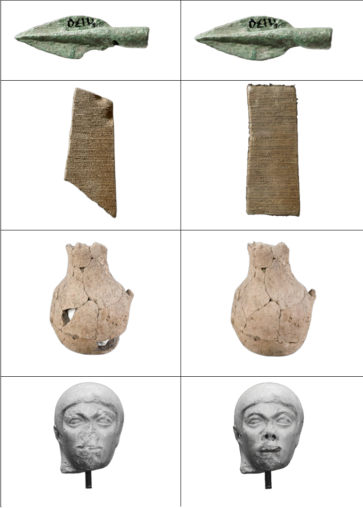

# Cultural Heritage Object Restoration



This repository represents the ENIGMA restoration component for Cultural Heritage (CH) object reconstruction workflows. The objective is to transform incomplete visual evidence into improved object representations that can be passed to downstream 3D reconstruction services. In practical terms, the system receives an image (or a text/document/audio description), prepares a plausible object depiction through classification, shape extraction, damage detection, and inpainting, and then forwards the resulting image to a dedicated 3D generation API.

Within CH use cases, artifacts such as tablets, statues, arrowheads, and vases are frequently fragmented, visually degraded, or only partially documented. This creates a pipeline challenge on how to produce a coherent object view from sparse or noisy input and keep the output interoperable with external reconstruction components. This codebase addresses that challenge by packaging restoration and multimodal-to-image preparation on API endpoints.

The restoration backbone combines object-type classification, shape-prior extraction, damage mask prediction, and inpainting. For description-driven scenarios, the service also supports text, PDF, and audio inputs, converts them to image prompts (Mistral + Stable Diffusion XL + Whisper/pdf parsing), generates an image, applies restoration, and then requests the final 3D asset from an external generator endpoint. The result is a service-ready orchestration layer for integration.

Within the broader ENIGMA pipeline, this API functions as the restoration and orchestration layer before 3D delivery. It can be invoked directly by client applications and returns binary 3D outputs produced by the external generator service, supporting modular integration and reproducible deployment.

API-first packaging of CH object restoration and multimodal orchestration for ENIGMA workflows.

This repository focuses on making restoration and pre-3D preparation operational as a service (FastAPI + Docker), so ENIGMA applications can call stable HTTP endpoints and receive ready-to-use 3D outputs.

## ENIGMA Goal

- expose restoration + generation orchestration through API endpoints,
- package runtime dependencies for reproducible GPU execution,
- organize model loading and cross-module pipeline handoff,
- support direct binary 3D response passthrough from the generator service (`.glb` or `.zip` OBJ package).

Main service entrypoint:

- `src/main.py` → FastAPI app with `/ch_object_generation/` and `/description_to_image/`

## Repository structure (high level)

- `src/main.py`: API server and orchestration endpoints
- `src/utils_pipeline.py`: restoration pipeline (classification, shape extraction, damage detection, inpainting)
- `src/classification/`: object type classifier modules
- `src/shape_extraction/`: shape-prior extraction components
- `src/damage_detection/`: damage mask prediction modules
- `src/inpainting/`: inpainting flow
- `src/text_to_image/`: text/document/audio-to-image generation flow
- `foundation_models/`: local model assets (Mistral, SD variants, other foundations)
- `sam2/` and `sam2_configs/`: SAM2-based segmentation support files
- `Dockerfile`: GPU container setup for serving

## API contract

### Endpoints

- `POST /ch_object_generation/`
- `POST /description_to_image/`

### Input

For `POST /ch_object_generation/`:
- `file`: uploaded CH object image (multipart file)
- `format_3d` (optional): output format forwarded to generator (default `glb`)

For `POST /description_to_image/`:
- `input_type`: one of `text`, `document`, `audio`
- `text`: required when `input_type=text`
- `document`: required when `input_type=document` (PDF or text file)
- `audio`: required when `input_type=audio`
- `format_3d` (optional): output format forwarded to generator (default `glb`)

### Output

- Binary 3D content returned by the external generator service.
- Typical behavior:
  - `format_3d=glb` → `.glb` binary response
  - OBJ mode (if supported by generator) → zipped asset package

## Quick start (local)

> Recommended: Linux + NVIDIA GPU + CUDA-compatible PyTorch.

1. Create environment (Python 3.11 recommended).
2. Install dependencies:

```bash
pip install -r requirements.txt
```

3. Ensure required model assets/checkpoints are available (for example under `foundation_models/` and `sam2/checkpoints/`).
4. Optionally configure external 3D generator URL:

```bash
export GENERATOR_API_URL="http://<generator-host>:8001/generate_3d_model/"
```

5. Start API:

```bash
uvicorn src.main:app --host 0.0.0.0 --port 8000
```

## Quick start (Docker)

Build:

```bash
docker build -t dasch-enigma-api .
```

Run (GPU):

```bash
docker run --gpus all -p 8000:8000 -e GENERATOR_API_URL="http://<generator-host>:8001/generate_3d_model/" dasch-enigma-api
```

The container command starts:

```bash
uvicorn src.main:app --host 0.0.0.0 --port 8000
```

## Example API calls

Generate 3D from uploaded CH image:

```bash
curl -X POST "http://localhost:8000/ch_object_generation/?format_3d=glb" \
  -H "accept: */*" \
  -H "Content-Type: multipart/form-data" \
  -F "file=@examples/object.png" \
  --output generated_object.glb
```

Generate 3D from text description:

```bash
curl -X POST "http://localhost:8000/description_to_image/" \
  -H "accept: */*" \
  -H "Content-Type: multipart/form-data" \
  -F "input_type=text" \
  -F "text=A small carved stone tablet with worn edges and central inscription" \
  -F "format_3d=glb" \
  --output generated_from_text.glb
```

Generate 3D from document:

```bash
curl -X POST "http://localhost:8000/description_to_image/" \
  -H "accept: */*" \
  -H "Content-Type: multipart/form-data" \
  -F "input_type=document" \
  -F "document=@examples/object_description.pdf" \
  -F "format_3d=glb" \
  --output generated_from_document.glb
```

## Notes for GitHub sharing

- Large model files and generated outputs should stay out of Git history (handled by root `.gitignore`).
- For reproducibility, document exact checkpoint/model snapshot versions used in `foundation_models/`.
- Keep attribution to upstream models and toolkits visible in derivative deployments.

## Acknowledgement

This project integrates multiple technologies for multimodal understanding, restoration, and 2D generation.

- Segment Anything 2 (SAM2): https://github.com/facebookresearch/sam2
- Stable Diffusion XL (Diffusers): https://huggingface.co/docs/diffusers/en/using-diffusers/sdxl
- Mistral Instruct: https://huggingface.co/mistralai/Mistral-7B-Instruct-v0.3
- OpenAI Whisper: https://github.com/openai/whisper
- rembg: https://github.com/danielgatis/rembg

## License and ownership

- This repository includes ENIGMA integration and orchestration work.
- Several core model components and weights originate from upstream projects with their own licenses.
- Review and comply with all upstream licenses and model usage/distribution terms.

---

Developed for **ENIGMA** cultural heritage restoration and reconstruction workflows.